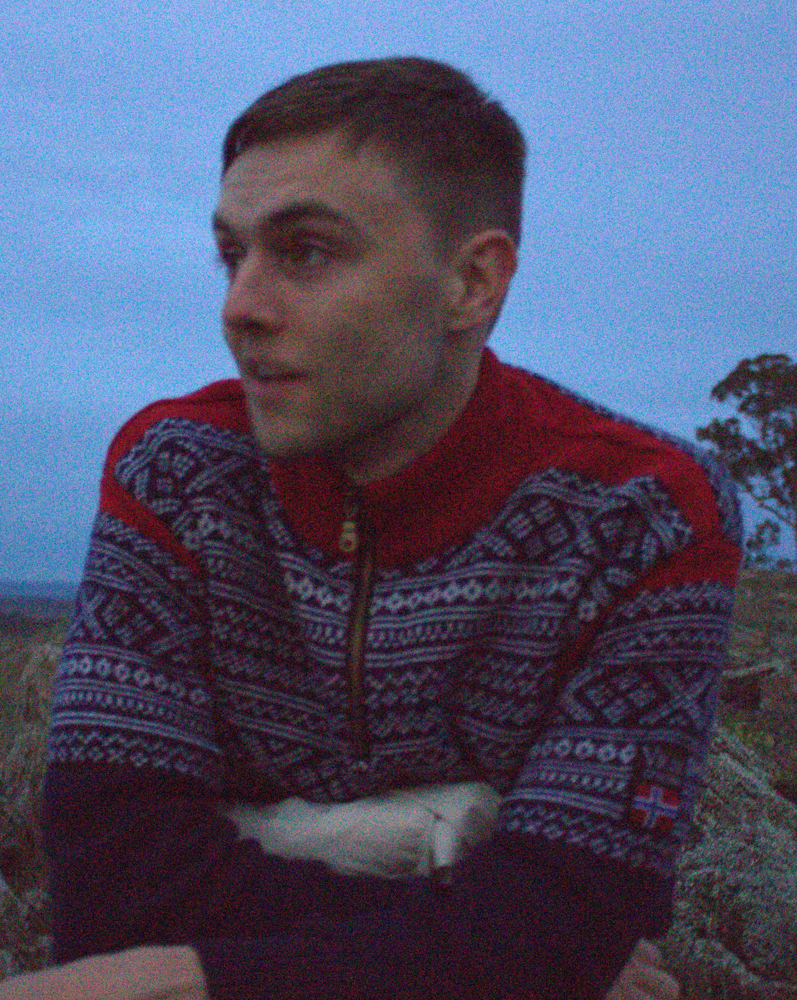

title: Gustav Kjærbye Bagger

mul #### Address
[School of Science](https://www.unsw.edu.au/canberra/about-us/our-schools/science)
[University of New South Wales, Canberra](https://www.unsw.edu.au/canberra)
Northcott Dr
Campbell ACT 2612
#### Email
[g.bagger@unsw.edu.au](mailto:g.bagger@unsw.edu.au)
mul 

#### About me

I am a 3rd year PhD candidate in number theory at UNSW Canberra, supervised by [Timothy Trudgian](https://www.unsw.edu.au/staff/timothy-trudgian) and [Bryce Kerr](https://www.unsw.edu.au/staff/bryce-kerr). Prior to that, I was an undergraduate at [Imperial College London](https://www.imperial.ac.uk/) and completed my master's degree at the [Norwegian University of Science and Technology](https://www.ntnu.edu/) under the supervision of [Markus Szymik](https://sheffield.ac.uk/mps/people/all-academic-staff/markus-szymik). 

My main research interests include 
- Cyclotomic fields 
- Splitting behaviour of prime ideals across Galois extensions 
- Artin's primitive root conjecture

 Previously, I have worked on problems related to finding primitive elements in subsets of finite fields and norm-Euclideanity in cyclic extensions. 

 Outside mathematics, I enjoy hiking, climbing, programming and boardgames.
